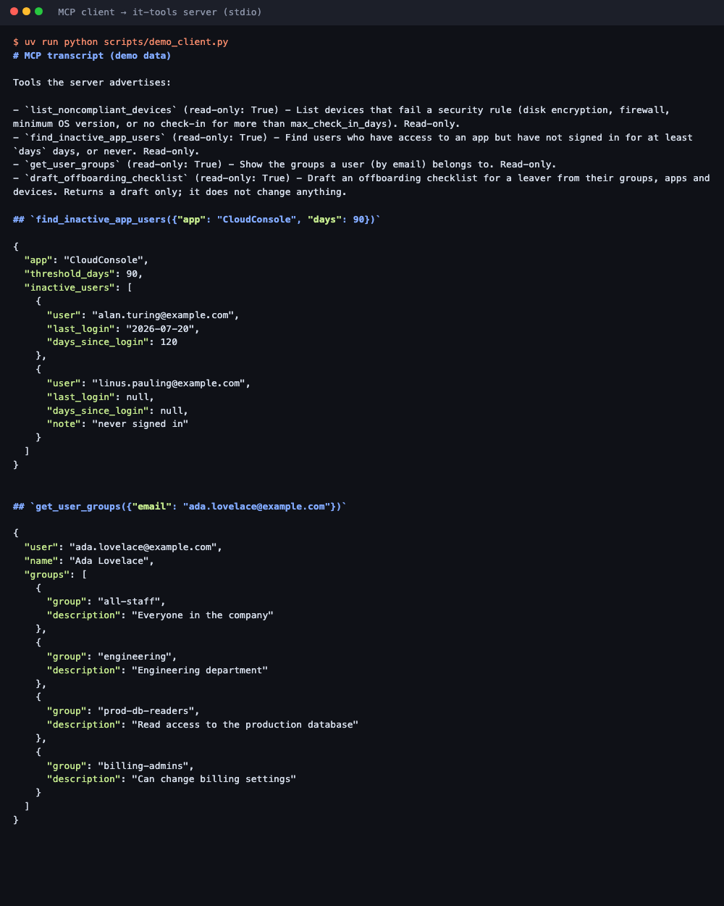
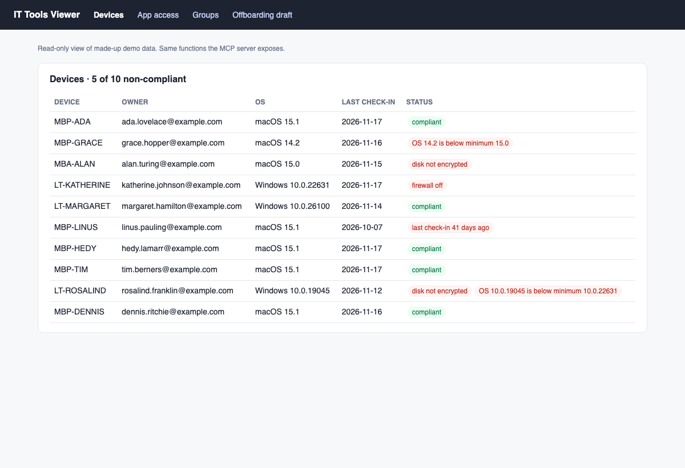
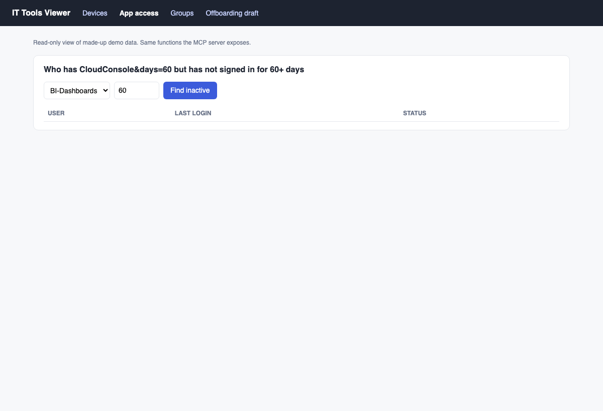
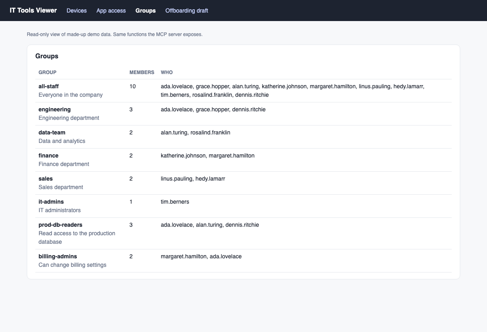
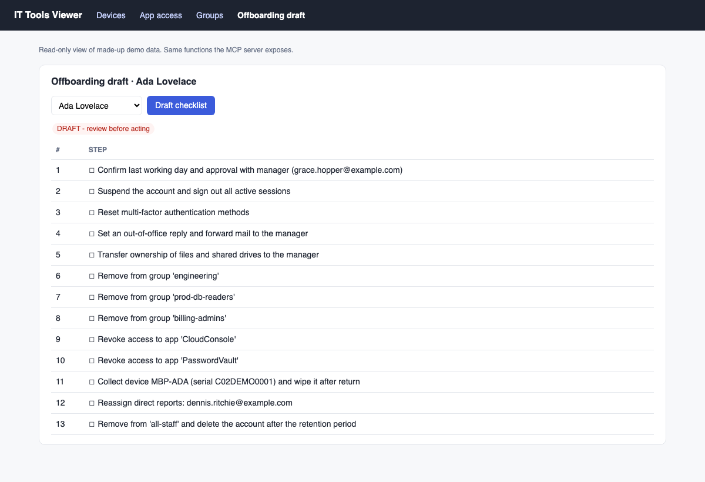

# poc.mcp-it-tools

A small **MCP server** that gives AI agents (Claude Code, Claude Desktop, or any
MCP client) four **read-only IT tools**, running over **made-up demo data**.

> **MCP** (Model Context Protocol) is an open standard for plugging tools into
> AI assistants. The assistant sees a list of tools with descriptions, decides
> when to call one, and gets JSON back.



## What it does

| Tool | Question it answers |
|---|---|
| `list_noncompliant_devices` | Which laptops break a security rule? (disk not encrypted, firewall off, OS too old, no check-in for 30+ days) |
| `find_inactive_app_users` | Who has access to app X but hasn't signed in for N days, or ever? (a common input to an access review) |
| `get_user_groups` | Which groups is this person in? |
| `draft_offboarding_checklist` | What needs to happen when this person leaves? (built from their groups, apps, devices and direct reports) |

### Safe by design

- **Read-only.** The adapter interface has no write methods at all, and a test
  checks that. Every tool is marked `readOnlyHint: true`, so MCP clients know
  nothing will change.
- **Drafts, not actions.** The offboarding tool returns a checklist marked
  `DRAFT - review before acting`. A person still does the work.
- **Demo data only.** Ten fictional users at `example.com`. Dates are stored as
  "days ago", so the demo never goes stale.

## Quick start

Needs [uv](https://docs.astral.sh/uv/) (a fast Python package manager).

```bash
git clone https://github.com/chamu262/poc.mcp-it-tools && cd poc.mcp-it-tools
uv sync
uv run pytest -q
```

See the tools work without any AI client:

```bash
uv run python scripts/demo_client.py
```

That script starts the server, calls every tool the same way an AI agent would,
and prints the results. Saved output: [docs/transcript.md](docs/transcript.md).

### Use it from Claude Code

```bash
claude mcp add it-tools -- uv run --directory "$(pwd)" mcp-it-tools
```

Or copy [`.mcp.json.example`](.mcp.json.example) to `.mcp.json` in your project
and fix the path. Then ask things like:

- "Which devices are non-compliant and why?"
- "Who has CloudConsole access but hasn't logged in for 90 days?"
- "Draft an offboarding checklist for linus.pauling@example.com."

### Web viewer

A one-file viewer (Python standard library only) shows the same data and tool
results in a browser, so you can see what the agent sees.

```bash
uv run mcp-it-viewer        # http://127.0.0.1:8765
```

| Devices | App access |
|---|---|
|  |  |
| **Groups** | **Offboarding draft** |
|  |  |

## How it fits together

```
AI agent (Claude Code)
      │  MCP over stdio
      ▼
server.py   ── registers 4 tools, all read-only
      │
tools.py    ── the actual logic, plain Python functions (easy to test)
      │
adapters/   ── where the data comes from
  base.py   ── ITAdapter interface: list_users / list_devices / list_groups / list_app_access
  demo.py   ── DemoAdapter, reads demo_data.json  ← the only one shipped
```

### Adding a real system

An **adapter** is a small class that fetches data from one system and returns
it in the shapes in [`models.py`](src/mcp_it_tools/models.py). To add, say, an
MDM (device management) or identity provider:

1. Write a class with the four `list_*` methods from
   [`adapters/base.py`](src/mcp_it_tools/adapters/base.py).
2. Register it in [`adapters/__init__.py`](src/mcp_it_tools/adapters/__init__.py).
3. Start the server with `MCP_IT_ADAPTER=<name>`.

Natural candidates: Jamf or Intune for devices, Entra ID or Google Workspace for
users, groups and sign-in logs. The tools don't change. Keep the API
credentials read-only too, so safety doesn't rely on the code alone.

## Project layout

Each folder has its own README:

| Folder | What's in it |
|---|---|
| [src/](src/README.md) | Holds the package |
| [src/mcp_it_tools/](src/mcp_it_tools/README.md) | Server, tools, viewer, demo data; table of the four tools |
| [src/mcp_it_tools/adapters/](src/mcp_it_tools/adapters/README.md) | Adapter interface and how to add a real system |
| [tests/](tests/README.md) | What each test checks |
| [scripts/](scripts/README.md) | The demo client that makes the transcript |
| [docs/](docs/README.md) | Transcript and screenshots |
| [.github/](.github/README.md) | CI workflow |

## License

MIT, see [LICENSE](LICENSE).
