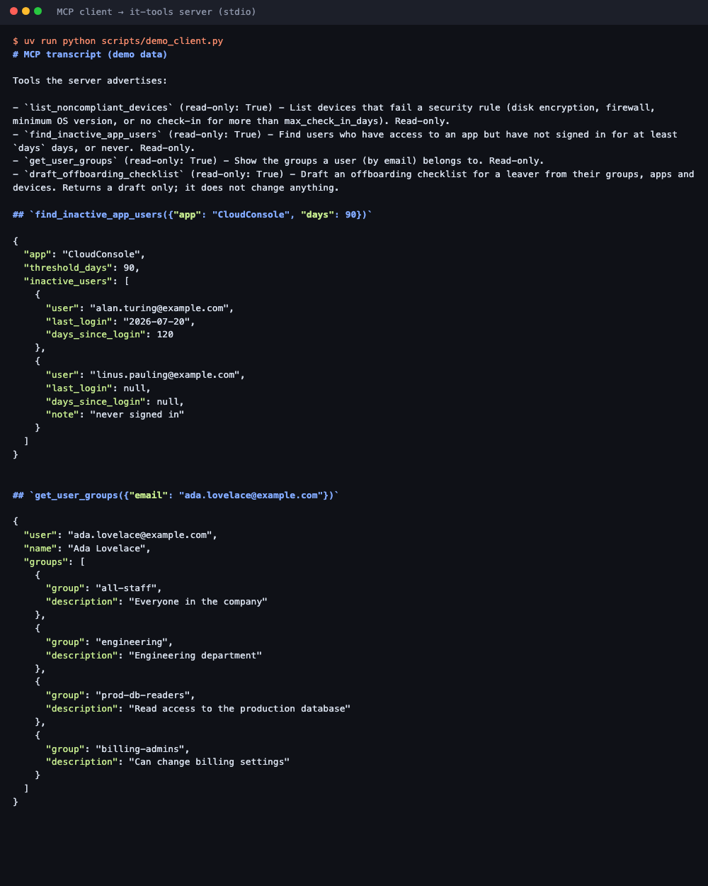

# docs/

Things to look at without running the code.

| File | What it is |
|---|---|
| [transcript.md](transcript.md) | Real output of [`scripts/demo_client.py`](../scripts/demo_client.py): the server's tool list and the JSON each tool returned. |
| [screenshots/](screenshots/) | Images used in the READMEs. |

Screenshots (all made-up demo data):

| File | Shows |
|---|---|
| [mcp-transcript.png](screenshots/mcp-transcript.png) | An MCP client calling the server over stdio |
| [viewer-devices.png](screenshots/viewer-devices.png) | Devices page: which laptops fail a rule and why |
| [viewer-app-access.png](screenshots/viewer-app-access.png) | Who has an app but hasn't signed in lately |
| [viewer-groups.png](screenshots/viewer-groups.png) | Groups and their members |
| [viewer-offboarding.png](screenshots/viewer-offboarding.png) | A draft offboarding checklist |

To refresh the transcript: `uv run python scripts/demo_client.py > docs/transcript.md`.
