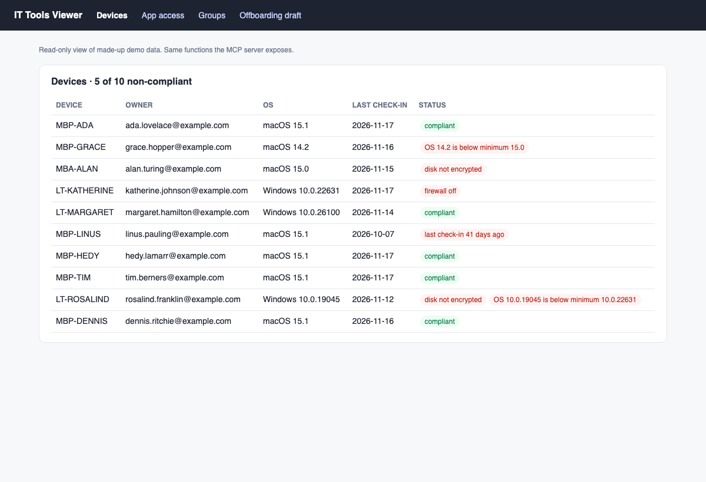
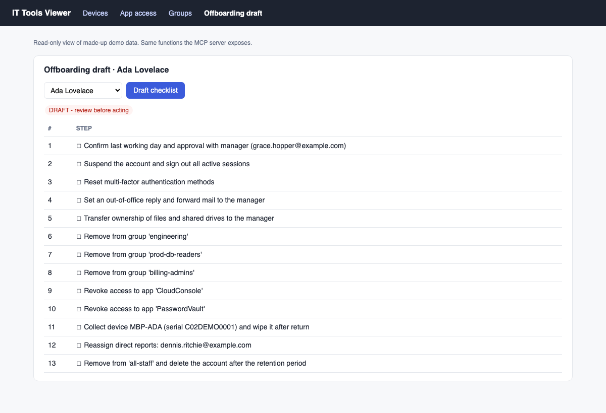

# mcp_it_tools/

The package. An AI agent talks to `server.py`; everything else feeds it.

| File | What it does |
|---|---|
| [server.py](server.py) | The MCP server. Registers the four tools and marks each one read-only. Command: `mcp-it-tools`. |
| [tools.py](tools.py) | The tool logic as plain Python functions. No MCP code, so they are easy to test and reuse. |
| [models.py](models.py) | The data shapes every adapter returns: `User`, `Device`, `Group`, `AppAccess`. |
| [adapters/](adapters/) | Where data comes from. Only the demo adapter ships. |
| [demo_data.json](demo_data.json) | Made-up users, devices, groups and app logins. Dates are "days ago", so the demo never goes stale. |
| [viewer.py](viewer.py) | A small read-only web page showing the same data and results. Command: `mcp-it-viewer`. |

## The four tools

All are read-only: they never change anything.

| Tool | Input | Returns |
|---|---|---|
| `list_noncompliant_devices` | `max_check_in_days` (default 30) | Count and list of devices, each with the reasons it fails: disk not encrypted, firewall off, OS too old, or no recent check-in |
| `find_inactive_app_users` | `app`, `days` (default 90) | Users with access to the app who haven't signed in for that long, or never |
| `get_user_groups` | `email` | The user's groups, with descriptions |
| `draft_offboarding_checklist` | `email` | A numbered checklist marked DRAFT: suspend account, remove groups, revoke apps, collect devices, reassign direct reports |

## Screenshots

| Devices | Offboarding draft |
|---|---|
|  |  |

More in [docs/](../../docs/).
